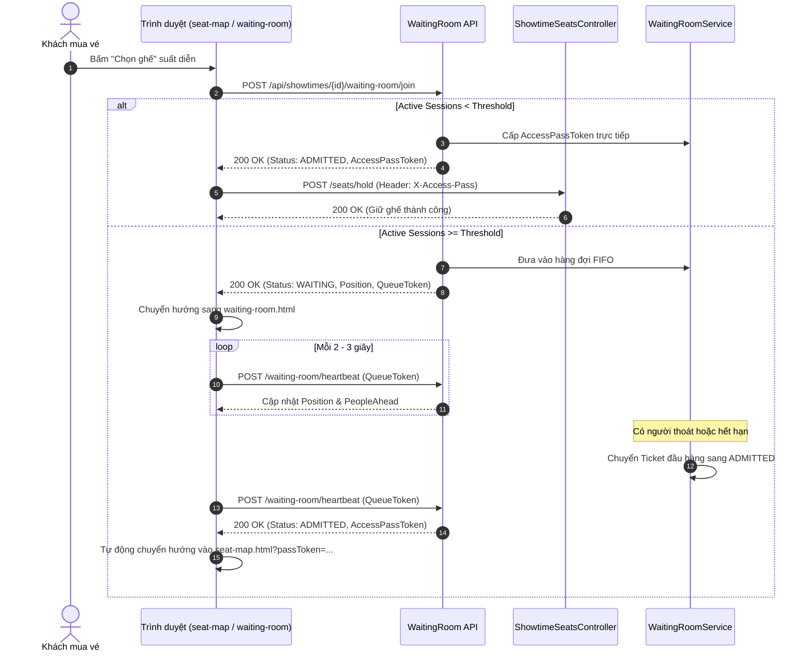

# S-40: Hàng đợi phòng chờ khi lượng truy cập vượt ngưỡng

**Mã Story:** S-40  
**Thuộc Epic:** E-07 (*Phòng chờ và chống bot khi mở bán*)  
**Sprint:** Sprint 6  
**Ước lượng:** 8 Story Points  
**Độ ưu tiên:** Should  
**Phụ thuộc (Dependencies):** S-13 (*Ghế đã có người giữ thì không ai khác chọn được, kể cả khi bấm cùng lúc*)

---

## 1. Mục tiêu & User Story

> **Là người mua vé**, tôi muốn biết mình đang ở vị trí thứ mấy trong hàng chờ để yên tâm đợi thay vì bấm lại liên tục khi lượng truy cập vượt ngưỡng.

---

## 2. Tiêu chí nghiệm thu (Acceptance Criteria - AC)

| STT | Tiêu chí | Mô tả chi tiết |
|---|---|---|
| **AC1** | **Kích hoạt phòng chờ khi vượt ngưỡng (Threshold-based Queue)** | Hệ thống quản lý ngưỡng số người chọn ghế hoạt động đồng thời (`ActiveThreshold`) theo từng suất diễn. Khi số phiên đang hoạt động vượt ngưỡng, người mới truy cập sẽ được chuyển vào Phòng chờ (Waiting Room) và nhận một mã xếp hàng (`QueueToken`) theo thứ tự đến (FIFO). Nếu dưới ngưỡng, người dùng được cấp lượt (`AccessPassToken`) trực tiếp không cần chờ. |
| **AC2** | **Hiển thị vị trí & tiến độ hàng đợi (Position & Progress)** | Tại trang phòng chờ (`waiting-room.html`), người mua vé thấy rõ: vị trí của mình trong hàng (`Position`), số người đang đứng trước (`PeopleAhead`), trạng thái hàng đợi và thanh tiến trình tự động cập nhật qua cơ chế Heartbeat polling. |
| **AC3** | **Đến lượt được vào chọn ghế với thời hạn (Admitted with Expiring Pass)** | Khi có người rời đi, đặt vé xong hoặc hết hạn, người đứng đầu hàng đợi được chuyển trạng thái sang `ADMITTED` và cấp vé thông hành (`AccessPassToken`) có thời hạn (mặc định 10 phút, khớp với chu kỳ giữ ghế S-10). Giao diện tự động điều hướng vào trang chọn ghế `seat-map.html`. |
| **AC4** | **Hết lượt hoặc mất kết nối thì mất chỗ (Timeout & Abandonment)** | Nếu người trong hàng chờ không gửi heartbeat trong 45 giây (tắt tab, mất mạng), hệ thống loại bỏ khỏi hàng để nhường lượt cho người sau. Nếu người đã được cấp lượt không thao tác trong thời hạn của pass (10 phút), lượt sẽ hết hạn và phải xếp hàng lại. |
| **AC5** | **Bảo vệ API chọn ghế và giữ ghế (API Guard)** | Khi phòng chờ kích hoạt cho suất diễn, các API truy cập sơ đồ ghế và giữ ghế (`POST /api/showtimes/{id}/seats/hold`) yêu cầu kèm `X-Access-Pass` hợp lệ. Nếu thiếu hoặc không hợp lệ, máy chủ trả về `HTTP 429 Too Many Requests` kèm đường dẫn vào phòng chờ. |
| **AC6** | **Cấu hình linh hoạt & Quản trị (Configuration & Management)** | Ngưỡng truy cập và thời gian hiệu lực có thể cấu hình trong `appsettings.json` hoặc điều chỉnh riêng theo từng suất diễn qua API quản trị. |

---

## 3. Thiết kế kỹ thuật & Luồng xử lý

